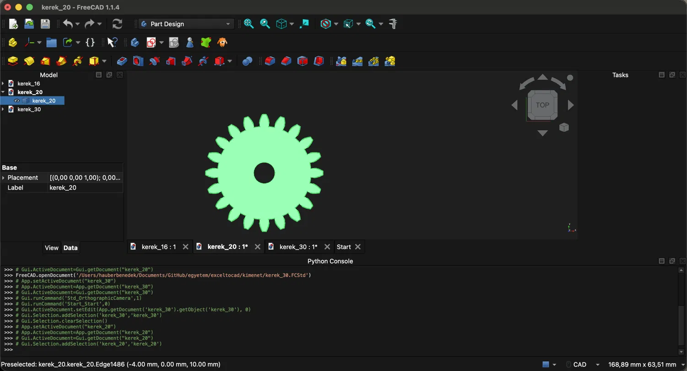
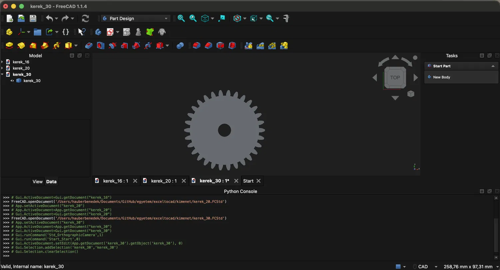
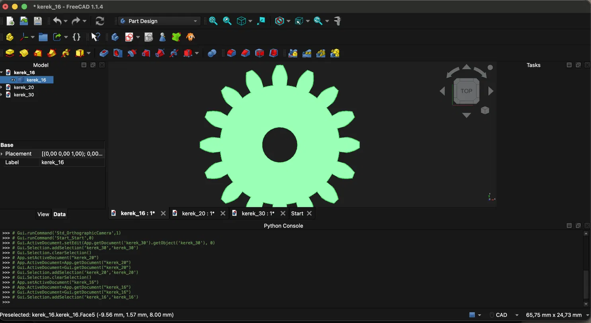

# Fogaskerék generátor Excelből

Ez a program egy Excel táblázatból automatikusan elkészíti fogaskerekek 3D modelljét. A táblázatba beírod a méreteket (például hány fogú legyen a kerék, mekkora legyen a furata), a program pedig legenerálja a modellt FreeCAD-ben.

Egyetemi projektfeladat, Széchenyi István Egyetem, mechatronikai mérnöki BSc. Készítette: Hauber Benedek.





## Hogyan működik

A program három lépésből áll:

1. **Excel**: az `adat/fogaskerekek.xlsx` fájlban soronként egy fogaskerék adatai vannak. -- lásd dokumentáció mappában példa excel kép.
2. **Beolvasás** (`forras/excel_olvaso.py`): beolvassa az Excelt, ellenőrzi az adatokat (például nem lehet túl kevés a fog), kiszámolja a szükséges méreteket, és elmenti őket egy JSON fájlba (`kimenet/fogaskerekek.json`).
3. **Modellezés** (`forras/fogaskerek_generator.py`): FreeCAD-ben a JSON adatokból elkészíti a fogaskereket, és elmenti `.FCStd` és `.step` fájlba.

Azért van két külön rész, mert a FreeCAD saját Pythonja nem ismeri az Excel olvasó csomagot (`openpyxl`). Így az Excel részt a normál Python futtatja, a FreeCAD pedig csak a JSON fájlt olvassa.

## Mi kell hozzá

- FreeCAD (1.1.4-es verzióval próbáltam)
- Python
- az `openpyxl` csomag (benne van a `requirements.txt`-ben)

Csak macOS-en teszteltem.

## Telepítés

```
git clone https://github.com/FELHASZNALONEV/exceltocad.git
cd exceltocad
python3 -m venv .venv
source .venv/bin/activate
pip install -r requirements.txt
```

## Használat
## !!Nagyon fontos a nevek helyessége, ha bármit is átnevezel a kód nem biztos hogy 100%-osan működik!!
1. Töltsd ki az `adat/fogaskerekek.xlsx` fájlt. Ha nincs ilyen, a `python3 minta_excel_keszito.py` készít egy mintát amit kézzel kitölthetsz (későbbi verzióban python excel generátort tervezek egyszerűbb használatért).
2. Olvasd be az Excelt (a projekt mappájából, bekapcsolt `.venv`-vel):
```
   python3 forras/excel_olvaso.py adat/fogaskerekek.xlsx
```
3. Generáld le a modelleket FreeCAD-del:
```
   /Applications/FreeCAD.app/Contents/Resources/bin/freecadcmd forras/fogaskerek_generator.py
```
4. Az eredmény a `kimenet` mappában lesz. Az `.FCStd` fájlt a FreeCAD-ben lehet megnyitni, a `.step` fájlt bármelyik CAD program tudja olvasni.

## Az Excel táblázat oszlopai

Minden sor egy fogaskerék. Az oszlopok neve pontosan ez legyen:

- `nev`: a kerék neve, ez lesz a fájl neve is (nem lehet két egyforma)
- `modul`: a fogak mérete milliméterben (nagyobb modul, nagyobb fogak)
- `fogszam`: hány foga van a keréknek (legalább 8)
- `nyomaszog`: a fogak kapcsolószöge fokban, általában 20
- `szelesseg`: milyen vastag a kerék milliméterben
- `furat_nevleges`: a középső furat névleges átmérője milliméterben
- `furat_felso`: a furat tűrésének felső eltérése (pl. 0,015)
- `furat_also`: a furat tűrésének alsó eltérése (pl. 0)
- `turesmod`: melyik méretre legyen a furat modellezve, lásd lent

## !!A tizedesvessző és a tizedespont is jó.!!

## Tűrés

A gyártásban egy méret soha nem lesz pontosan az, ami a rajzon van, ezért megadják, mennyivel lehet kisebb vagy nagyobb. Ezt hívják tűrésnek. A program a furatnál kezeli ezt. A `turesmod` oszlopba ezek egyikét lehet írni:

- `nevleges`: a névleges méretre modellez
- `min`: a legkisebb megengedett méretre
- `max`: a legnagyobb megengedett méretre
- `kozep`: a tűrésmező közepére

Példa: névleges furat 8 mm, felső eltérés +0,015, alsó eltérés 0. Ekkor `nevleges` esetén 8,000 mm, `min` esetén 8,000 mm, `max` esetén 8,015 mm, `kozep` esetén 8,0075 mm lesz a furat.

## A fogak alakja

A fogaskerék fogainak oldala nem egyenes, hanem **evolvens** görbe. Ezt a görbét úgy kapod, hogy egy cérnát lecsévélsz egy hengerről: a cérna végpontja rajzolja ki az evolvenst. Ilyen fogaknál két kerék egyenletesen gördül egymáson. A programban ezt a `forras/evolvens.py` számolja ki, fogoldalanként 15 pontból.

A fontosabb méretek:

- osztókör átmérője = modul · fogszám
- fejkör átmérője (a fogak teteje) = osztókör + 2 · modul
- lábkör átmérője (a fogárkok alja) = osztókör - 2,5 · modul
- alapkör átmérője = osztókör · cos(nyomásszög), erről indul az evolvens

## Mappák

- `adat/`: a bemeneti Excel
- `forras/`: a programok (`excel_olvaso.py`, `evolvens.py`, `fogaskerek_generator.py`)
- `tesztek/`: az automatikus tesztek
- `kimenet/`: a program által készített fájlok
- `dokumentacio/`: képek

## Tesztek

```
python3 -m unittest discover -s tesztek -p "teszt*.py" -v
```

A tesztek ellenőrzik az Excel beolvasást (jó és hibás adatokkal) és a fogprofilt (például hogy a fog vastagsága az osztókörön a szabványos érték, és hogy a kerék szimmetrikus).

## Korlátok

- Csak egyenes fogú fogaskereket készít.
- A fogak oldala sok kis egyenes szakaszból áll, nem teljesen sima görbe.
- A fogak tövénél egyszerűsítést használ (nincs lekerekítés), ezért a kisebb fogszámú kerekek fogai tőnél kicsit keskenyebbek.
- A tűrés csak a furat méretére hat.